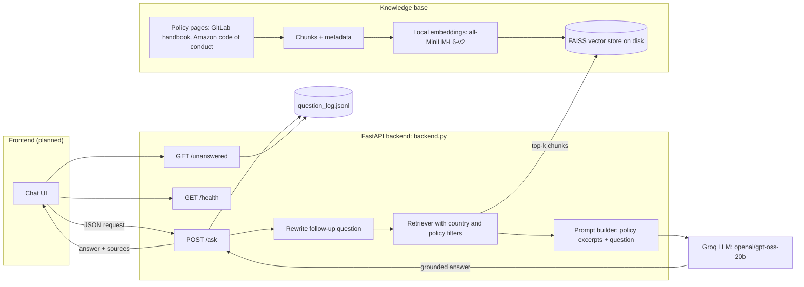
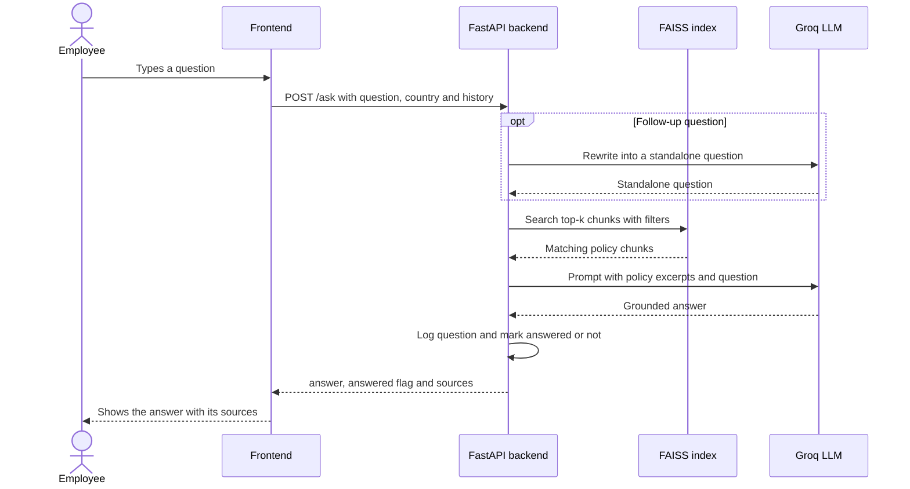
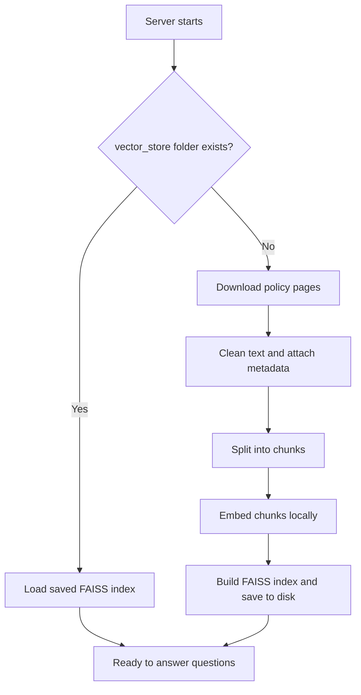

# HR Assistant RAG Chatbot

An AI assistant that answers employees' HR policy questions **only from the company's own policy documents**, shows **which policy** each answer came from, and tells HR **which questions the documents could not answer**.

Built with **FastAPI**, **LangChain**, **Groq** (LLM), local **HuggingFace embeddings** and **FAISS**.

> **Status:** the backend API is complete. The frontend (`Frontend/`) is planned.

---

## The problem

HR teams answer the same questions every week: *"How much parental leave do I get?"*, *"Can I use PTO instead of sick leave?"* Employees wait for answers, and HR loses hours. This project answers those questions instantly, with sources, and refuses to guess.

## Features

- **Grounded answers:** the model may only use the retrieved policy excerpts. If the answer isn't there, it says so and points to HR.
- **Sources on every answer:** policy title, URL, country and a text snippet.
- **Country and policy-type filters:** an employee in France gets France's rules plus the global ones.
- **Follow-up questions:** "and for adoption?" is rewritten into a full question before searching.
- **Unanswered-questions report:** `/unanswered` shows HR which policies are missing or unclear.
- **Persistent index:** documents are indexed once and saved to disk, so restarts are fast.
- **Stateless API:** the frontend sends the chat history with each request.

---

## Architecture



### What happens when a question arrives



### What happens when the server starts



---

## Tech stack

| Part | Tool |
|---|---|
| API | FastAPI + Uvicorn |
| LLM | Groq (`openai/gpt-oss-20b` by default) via `langchain-groq` |
| Embeddings | `sentence-transformers/all-MiniLM-L6-v2` (runs locally, free) |
| Vector store | FAISS (saved to disk) |
| Orchestration | LangChain |
| Data loading | `WebBaseLoader` + BeautifulSoup |

Groq provides chat models only, not embedding models, which is why the embeddings run locally.

## Project structure

```
HR-Assistant-RAG-Chatbot/
├── Backend/
│   └── backend.py          # the whole API: load, index, retrieve, generate
├── Frontend/               # planned
├── requirements.txt
├── .gitignore
└── README.md
```

Created automatically when you run it (not committed): `Backend/vector_store/` (saved index) and `Backend/question_log.jsonl` (question log). You create `Backend/.env` yourself.

---

## Getting started

**Requirements:** Python 3.10+ and a free Groq API key from [console.groq.com/keys](https://console.groq.com/keys).

```bash
git clone https://github.com/Fahadqureshi0/HR-Assistant-RAG-Chatbot.git
cd HR-Assistant-RAG-Chatbot

python -m venv env
env\Scripts\activate              # Windows  (macOS/Linux: source env/bin/activate)
pip install -r requirements.txt
```

Create a file named `Backend/.env` containing your key:

```
GROQ_API_KEY=gsk_your_key_here
```

Start the server:

```bash
cd Backend
uvicorn backend:app --reload
```

Wait for **Ready**. The first start is slow because it downloads the embedding model (about 90 MB) and the policy pages, then saves the index. Later starts load the saved index.

Open **http://127.0.0.1:8000/docs** to try the API from your browser.

## API

| Endpoint | Description |
|---|---|
| `GET /health` | Server status, number of indexed chunks, model name |
| `POST /ask` | Ask a question and get an answer with sources |
| `GET /unanswered` | Questions the documents could not answer |

**Request: `POST /ask`**

```json
{
  "question": "How many weeks of paid parental leave do I get?",
  "country": "France",
  "policy_type": "leave",
  "history": [
    {"role": "user", "content": "Hi"},
    {"role": "assistant", "content": "Hello! Ask me about company policies."}
  ]
}
```

`country`, `policy_type` and `history` are optional. Policy types: `leave`, `time_off`, `benefits`, `conduct`.

**Response** (illustrative values)

```json
{
  "answer": "According to the Leave Types policy, ...",
  "answered": true,
  "rewritten_question": "How many weeks of paid parental leave do I get?",
  "sources": [
    {
      "title": "GitLab - Leave Types (incl. Parental Leave)",
      "source": "https://handbook.gitlab.com/...",
      "country": "Global",
      "policy_type": "leave",
      "snippet": "..."
    }
  ]
}
```

When the answer is not in the documents, `answered` is `false` and the assistant replies that it couldn't find it and suggests contacting HR.

## Configuration

| Setting | Where | Notes |
|---|---|---|
| `GROQ_API_KEY` | `Backend/.env` | required |
| `LLM_MODEL` | `Backend/.env` or default in `backend.py` | if you get a "model not found" error, pick a current model from [Groq's model list](https://console.groq.com/docs/models) |
| `SOURCES` | `backend.py` | the documents to index, each with country and policy type |
| `CHUNK_SIZE`, `CHUNK_OVERLAP`, `K` | `backend.py` | text chunking and how many chunks to retrieve |
| `ALLOWED_ORIGINS` | `backend.py` | addresses your frontend runs on (CORS) |

To re-index after changing `SOURCES` or after a source page changes, delete `Backend/vector_store/` and restart the server.

## Data sources

The demo uses public policy pages:

- GitLab's open handbook: time off, leave, US leave of absence, benefits, France benefits
- Amazon's public Code of Business Conduct and Ethics

This project is not affiliated with GitLab or Amazon. Their content belongs to its owners. Check each source's license or terms before reusing it, and credit them. For real clients, use their own documents and keep them private.

## Design decisions

- **Grounding first:** a strict prompt plus a fixed "not found" sentence lets the code detect unanswered questions automatically.
- **Metadata on every chunk:** company, country and policy type enable filtering and clear source labels.
- **Global policies always included:** a country filter returns that country's rules plus the ones that apply everywhere.
- **Stateless backend:** the client owns the chat history, which keeps the server simple and easy to scale.
- **Saved index:** avoids re-downloading and re-embedding on every restart.

## Limitations

- Answers are only as good as the retrieved text. Always check important answers against the source link.
- Source pages can change, and the index must be rebuilt to pick that up.
- No authentication yet, and questions are stored in plain text in the log file. Add access control and a retention policy before using real employee data.
- Free Groq keys have rate limits.
- **Not legal or HR advice.**

## Roadmap

- [ ] Frontend chat interface with source cards and a country filter
- [ ] Evaluation set with retrieval and answer scores
- [ ] Hybrid search and a reranker
- [ ] Authentication and per-company document isolation
- [ ] Docker and deployment

## Author

Built by [Fahadqureshi0](https://github.com/Fahadqureshi0).
